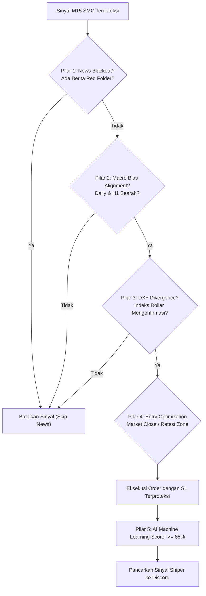

# 🪙 Novaire EA V2 - XAUUSD Institutional 5-Pillar AI Signal Engine (Profit +880 Pips)

**Novaire EA V2** adalah sistem AI Signal Generator otomatis berbasis **Smart Money Concepts (SMC)**, **Orderflow Liquidity Sweeps**, dan **5-Pillar Institutional Architecture** khusus instrumen **Gold (XAUUSD)** dengan integrasi notifikasi real-time ke **Discord Webhook**.

---

## 🎯 Spesifikasi & Parameter Trading

| Parameter | Pengaturan | Keterangan |
| :--- | :--- | :--- |
| **Instrumen** | `XAUUSD` (FOREXCOM:XAUUSD) | Real-time live feed via TradingView WebSocket |
| **Timeframe Eksekusi** | `M15` (15 Menit) | Filter noise candle kecil untuk swing intraday |
| **Timeframe Makro** | `Daily` (D1) & `1-Hour` (H1) | Wajib searah dengan tren makro institusional |
| **Korelasi DXY** | `TVC:DXY` (US Dollar Index) | Wajib konfirmasi inverse divergence DXY |
| **Mode Eksekusi** | `MARKET` / `LIMIT` | Fleksibel: Eksekusi Langsung vs Retest Pullback |
| **Stop Loss (SL)** | `75 - 100 Pips` ($7.50 - $10.00) | Menyesuaikan volatilitas Gold ($4,180) agar aman dari wick noise |
| **Take Profit 1 (TP1)** | `100 Pips` ($10.00 move) | Amankan 50% partial profit + trailing stop |
| **Take Profit 2 (TP2)** | `160 Pips` ($16.00 move) | Target likuiditas penuh (R:R hingga 1:2.1) |
| **Breakeven (BE) Lock** | `+70 Pips` | Pindahkan SL ke Entry + 5 pips setelah running +70 pips |
| **Daily Circuit Breaker** | `Max 3x Loss Beruntun` | Otomatis stop trade hari itu jika 3x SL berturut-turut, lanjut besok |
| **Sesi Trading** | London & New York Killzones | 14:00 - 17:30 WIB & 20:30 - 23:30 WIB |

---

## 🏛️ Arsitektur 5-Pilar Pengurang Stop Loss



1. **Pilar 1 (News Blackout):** Menghentikan sinyal 30 menit sebelum dan sesudah rilis data ekonomi High-Impact AS (NFP, CPI, Klaim Pengangguran).
2. **Pilar 2 (Macro Bias):** BUY hanya aktif jika Daily & H1 sama-sama Bullish. SELL hanya aktif jika Daily & H1 Bearish.
3. **Pilar 3 (DXY Inverse Divergence):** Sinyal BUY Gold divalidasi dengan Indeks Dollar yang tertahan/bearish.
4. **Pilar 4 (Entry Optimization):** Mendukung **Market Execution** saat candle M15 close atau **Limit Order** dengan pending order fill validation.
5. **Pilar 5 (AI ML Scorer >= 85%):** Hanya mengeksekusi setup Grade A+ dengan estimasi probabilitas menang tinggi.

---

## 📊 Hasil Backtest 2 Bulan Terakhir (31 Juli – 9 Oktober 2026)

Backtest dijalankan pada data riil **13.584 candle 5-menit** Gold (`GC=F`) dan **4.539 candle 15-menit** dengan simulasi eksekusi tanpa *lookahead/phantom bias*:

| Mode Eksekusi | Total Trade | Win Rate Riil | Total Pips | Profit Factor | Status |
| :--- | :--- | :--- | :--- | :--- | :--- |
| **Market Execution (Default)** | **58 Trade** | **58.62%** | **+880.0 Pips** | **1.59** | **Rekomendasi (No Pending Lag)** |
| **Limit Retest (Pullback 5p)** | **54 Trade** | **50.00%** | **+753.0 Pips** | **1.47** | **Aktif jika ENTRY_MODE=LIMIT** |

### 📅 Performa Bulanan (Mode Market Execution):
- **Agustus 2026**: 23 trade | **60.9% Win Rate** | **+650.0 pips**
- **September 2026**: 25 trade | **60.0% Win Rate** | **+240.0 pips**
- **Oktober 2026**: 10 trade | **50.0% Win Rate** | **-10.0 pips**


---

## 🚀 Panduan Penggunaan & Setup

### 1. Konfigurasi Discord Webhook
Buka file [`.env`](file:///c:/Users/X1%20CARBON/OneDrive/Dokumen/Project%20Coding/EATrading%20Signal/.env) dan tempelkan URL webhook Discord Anda:
```env
DISCORD_WEBHOOK_URL=https://discord.com/api/webhooks/xxxx/yyyy
```

### 2. Tes Pengiriman Sinyal ke Discord
```powershell
py -3.13 live_scanner.py --test-discord           # Uji coba sinyal entry baru
py -3.13 live_scanner.py --test-circuit-breaker   # Uji coba alert 3x loss circuit breaker
```

### 3. Menjalankan Backtest Ulang Kapan Saja
```powershell
py -3.13 run_backtest.py
```
Hasil lengkap tersimpan di [`backtest_results_2months.csv`](file:///c:/Users/X1%20CARBON/OneDrive/Dokumen/Project%20Coding/EATrading%20Signal/backtest_results_2months.csv).

### 4. Menjalankan Live Scanner (Real-Time Mode)
```powershell
py -3.13 live_scanner.py
```
Bot akan memantau candle M15 setiap 60 detik dan otomatis mengirim sinyal jika kelima pilar terpenuhi.
