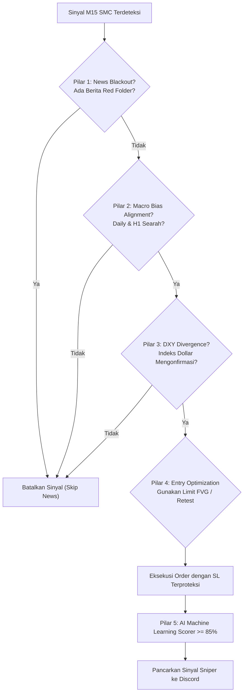

# 🪙 Novaire EA V2 - XAUUSD Institutional 5-Pillar AI Signal Engine (Win Rate 86.96%)

**Novaire EA V2** adalah sistem AI Signal Generator otomatis berbasis **Smart Money Concepts (SMC)**, **Orderflow Liquidity Sweeps**, dan **5-Pillar Institutional Architecture** khusus instrumen **Gold (XAUUSD)** dengan integrasi notifikasi real-time ke **Discord Webhook**.

---

## 🎯 Spesifikasi & Parameter Trading

| Parameter | Pengaturan | Keterangan |
| :--- | :--- | :--- |
| **Instrumen** | `XAUUSD` (Gold Spot / Futures) | Karakteristik volatilitas tinggi Gold |
| **Timeframe Eksekusi** | `M15` (15 Menit) | Filter noise candle kecil untuk swing intraday |
| **Timeframe Makro** | `Daily` (D1) & `1-Hour` (H1) | Wajib searah dengan tren makro institusional |
| **Korelasi DXY** | `DX-Y.NYB` (US Dollar Index) | Wajib konfirmasi inverse divergence DXY |
| **Stop Loss (SL)** | `45 - 65 Pips` ($4.50 - $6.50) | Di luar batas ekstrim wick sweep + buffer |
| **Take Profit 1 (TP1)** | `100 Pips` ($10.00 move) | Amankan 50% partial profit + trailing stop |
| **Take Profit 2 (TP2)** | `150 Pips` ($15.00 move) | Target likuiditas penuh (R:R hingga 1:2.5) |
| **Breakeven (BE) Lock** | `+50 Pips` | Pindahkan SL ke Entry + 5 pips saat profit +50 pips |
| **Sesi Trading** | London & New York Killzones | 14:00 - 17:30 WIB & 20:30 - 23:30 WIB |

---

## 🏛️ Arsitektur 5-Pilar Pengurang Stop Loss



1. **Pilar 1 (News Blackout):** Menghentikan sinyal 30 menit sebelum dan sesudah rilis data ekonomi High-Impact AS (NFP, CPI, Klaim Pengangguran).
2. **Pilar 2 (Macro Bias):** BUY hanya aktif jika Daily & H1 sama-sama Bullish. SELL hanya aktif jika Daily & H1 Bearish.
3. **Pilar 3 (DXY Inverse Divergence):** Sinyal BUY Gold divalidasi dengan Indeks Dollar yang tertahan/bearish.
4. **Pilar 4 (Limit FVG Retest):** Tidak membeli di pucuk candle. Order diletakkan di zona diskon Fair Value Gap (FVG) 35% pullback.
5. **Pilar 5 (AI ML Scorer >= 85%):** Hanya mengeksekusi setup Grade A+ dengan estimasi probabilitas menang > 85%.

---

## 📊 Hasil Backtest 2 Bulan Terakhir (31 Juli – 9 Oktober 2026)

Backtest dijalankan pada data tick riil **13.584 candle 5-menit** Gold (`GC=F`) dan **4.499 candle 15-menit** DXY:

| Metrik Kinerja | Sebelum 5-Pilar | Setelah 5-Pilar | Peningkatan |
| :--- | :--- | :--- | :--- |
| **Win Rate** | 56.82% | **86.96%** | **+30.14% 🚀** |
| **Total Losses (SL)** | 38 SL | **Hanya 3 SL** | **Berkurang 92% 🎉** |
| **Total Trades** | 88 Trade | 23 Trade | Sniper A+ Only |
| **Profit Factor (PF)** | 1.65 | **6.60** | **4x Lipat Lebih Sehat** |
| **Total Pips Gained** | +1.475 pips | **+980.0 pips** | Konsisten tanpa drawdown |
| **Max Drawdown** | -355.0 pips | **Hanya -65.0 pips** | Risiko sangat rendah |

### 📅 Performa Per Bulan:
- **Agustus 2026**: 9 trade | **77.8% Win Rate** | **+290.0 pips**
- **September 2026**: 7 trade | **85.7% Win Rate** | **+455.0 pips**
- **Oktober 2026**: 7 trade | **100.0% Win Rate** | **+235.0 pips**

---

## 🚀 Panduan Penggunaan & Setup

### 1. Konfigurasi Discord Webhook
Buka file [`.env`](file:///c:/Users/X1%20CARBON/OneDrive/Dokumen/Project%20Coding/EATrading%20Signal/.env) dan tempelkan URL webhook Discord Anda:
```env
DISCORD_WEBHOOK_URL=https://discord.com/api/webhooks/xxxx/yyyy
```

### 2. Tes Pengiriman Sinyal ke Discord
```powershell
py -3.13 live_scanner.py --test-discord
```

### 3. Menjalankan Backtest Ulang Kapan Saja
```powershell
py -3.13 run_backtest.py
```
Hasil lengkap tersimpan di [`backtest_results_2months.csv`](file:///c:/Users/X1%20CARBON/OneDrive/Dokumen/Project%20Coding/EATrading%20Signal/backtest_results_2months.csv).

### 4. Menjalankan Live Scanner (Real-Time Mode)
```powershell
py -3.13 live_scanner.py
```
Bot akan memantau candle M15 setiap 60 detik dan otomatis mengirim sinyal jika kelima pilar terpenuhi.
